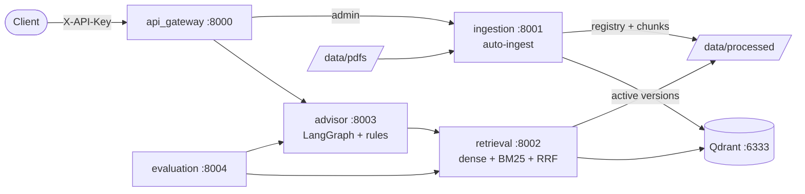

# Genz Skool Career Advisor

A grounded RAG **career and course advisor** for [Genz Skool](https://genzskool.com), a practical
skills academy in Sargodha, Pakistan. It recommends which Genz Skool course(s) to take, in what
order and at what cost, using **only** the knowledge base in `data/pdfs/`. It never invents fees,
syllabi, salaries or outcomes.

Built as five small hexagonal (ports and adapters) microservices. Everything runs offline with
**fake LLM and embedding providers, so no API keys are needed** to try it.

## Status

| Phase | Scope | State |
|---|---|---|
| 1. Foundation | shared contracts, logging, errors, settings, Docker, CI | done |
| 2. Ingestion | PDF to chunks to vectors, **auto-ingest** (startup, folder watcher, self-heal) | done |
| 3. Retrieval | hybrid dense + BM25 search, RRF, filters, thresholds, degradation | done |
| 4. Advisor | LangGraph flow, recommendation rules, grounding check, sessions | next |
| 5. Gateway | auth, rate limiting, streaming, resilience | planned |
| 6. Evaluation | golden set, metrics, CI gate | planned (retrieval gate already active) |
| 7. Hardening | docs, security tests, end-to-end chat | planned |

Until Phases 4-5 land, the chat endpoint is not available; ingestion (`:8001`) and retrieval
(`:8002`) are fully usable.

## Architecture



| Service | Port | Responsibility |
|---|---|---|
| `api_gateway` | 8000 | Public edge: auth, rate limits, CORS, routing (Phase 5) |
| `ingestion` | 8001 | Parse, chunk, embed, upsert; versioned blue/green index; auto-ingest |
| `retrieval` | 8002 | Hybrid search with metadata filters; returns `[]` when nothing is relevant |
| `advisor` | 8003 | Conversation, recommendations, grounded answers (Phase 4) |
| `evaluation` | 8004 | Offline/online evaluation and the regression gate (Phase 6) |

Details: [docs/ARCHITECTURE.md](docs/ARCHITECTURE.md) and the decision records in [docs/adr/](docs/adr/).

## Quickstart (Docker, no keys)

Requirements: Docker with Compose v2 (Docker Desktop on Windows/macOS).

```bash
cp .env.example .env            # optional: every key is a placeholder; fake providers are the default
make up                         # or: docker compose up -d --build --wait
```

On **Linux**, containers run as uid 10001 and write to the bind-mounted `data/processed/`;
`make up` makes it writable. Without make, run `chmod a+rwX data/processed` once first.

The ingestion service **indexes `data/pdfs/` automatically on startup** and re-checks the
folder every 15 seconds: add, replace or delete a PDF and the index follows.

```bash
# What is indexed (and the auto-ingest state)
curl -s localhost:8001/v1/ingest/status

# Search (hybrid dense + keyword, with filters)
curl -s localhost:8002/v1/search -H 'Content-Type: application/json' \
  -d '{"query": "How much is the eBay course?"}'
curl -s localhost:8002/v1/search -H 'Content-Type: application/json' \
  -d '{"query": "beginner courses", "filters": {"max_fee_pkr": 30000, "doc_types": ["course"]}}'

make ingest                     # force a report: sh scripts/ingest_all.sh (Windows: python scripts/dev.py ingest)
make down
```

The chunks are inspectable on the host in `data/processed/` (`registry.json` plus
`<doc>.v<N>.chunks.jsonl`).

### Using real providers
Only `.env` changes. Pick providers, set their keys and models, then re-ingest
(`FORCE=true make ingest`), because the embedding model determines the index:

```dotenv
LLM_PROVIDER=anthropic          # anthropic | openai | ollama | fake
LLM_API_KEY=...
LLM_MODEL=...
EMBEDDING_PROVIDER=voyage       # voyage | openai | sentence_transformers | fake
EMBEDDING_API_KEY=...
EMBEDDING_MODEL=...
EMBEDDING_DIM=1024              # must match the model
```

When switching embedding models, re-check `dense_min_score` in `config/retrieval.yaml` with
`make eval` (see [ADR-0003](docs/adr/0003-hybrid-retrieval.md)).

## Local development (Python 3.12)

```bash
py -3.12 -m venv .venv                     # Linux/macOS: python3.12 -m venv .venv
. .venv/Scripts/activate                   # Linux/macOS: . .venv/bin/activate
pip install -r requirements.txt            # every service's pinned deps + dev tools
pre-commit install
```

| Command | What it does |
|---|---|
| `python scripts/dev.py check` | lint + `mypy --strict` + all unit/contract/architecture tests |
| `python scripts/dev.py test [target]` | targets: `common`, `architecture`, a service name, `e2e` |
| `python scripts/dev.py eval` | evaluation gate (fails if a threshold is missed) |
| `python scripts/dev.py test e2e` | end-to-end tests against the running Docker stack |
| `python scripts/dev.py smoke-local` | boot every service with uvicorn (no Docker) and probe it |
| `python scripts/dev.py fixtures` | regenerate `tests/fixtures/kb` from the real PDF |
| `python scripts/dev.py ingest` | trigger ingestion on the running stack |

The `Makefile` wraps the same commands (`make check`, `make test`, `make eval`, ...). Keep the
venv **activated when committing**, because the pre-commit hooks call `python scripts/dev.py`.

Each service uses the package name `app`, so every service is tested in its own process with its
own `PYTHONPATH` (see [ADR-0010](docs/adr/0010-packaging-and-layout.md)). Use `dev.py`, not a
bare `pytest` at the repo root.

### Tests
- Unit, contract (every adapter passes its port's suite) and architecture tests: the layer rule
  `api -> application -> domain <- infrastructure` is enforced, and services never import each other.
- Coverage gate: >= 85% on every `domain/` and `application/` package (currently 99-100%).
- Real-PDF tests pin every course, fee, mentor and policy, and prove that **every word and number
  in every chunk exists in the PDF**.
- End-to-end tests against the live stack: auto-ingest, index-version swaps, a Qdrant outage
  drill, crash/restart recovery, graceful shutdown, JSON logs.

## Configuration

Secrets and deployment settings come from the environment (`.env`, never committed); behaviour
tuning lives in `config/*.yaml` (versioned).

| Variable | Default | Purpose |
|---|---|---|
| `LLM_PROVIDER` / `LLM_API_KEY` / `LLM_MODEL` | `fake` | Answer generation (advisor) |
| `EMBEDDING_PROVIDER` / `EMBEDDING_API_KEY` / `EMBEDDING_MODEL` / `EMBEDDING_DIM` | `fake` / 1024 | Shared by ingestion and retrieval |
| `RERANKER_PROVIDER` / `RERANKER_API_KEY` / `RERANKER_MODEL` | `none` | Optional reranker (also `use_reranker` in `config/retrieval.yaml`) |
| `VECTOR_STORE`, `QDRANT_URL`, `QDRANT_COLLECTION` | `qdrant` | Vector store |
| `AUTO_INGEST_ON_STARTUP` / `AUTO_INGEST_INTERVAL_S` / `AUTO_INGEST_PRUNE` | `true` / 15 / `true` | Auto-ingest ([ADR-0011](docs/adr/0011-auto-ingest.md)) |
| `GATEWAY_API_KEY`, `ADMIN_API_KEY` | placeholder | Gateway auth; `APP_ENV=prod` refuses weak values |
| `APP_ENV` | `dev` | `dev` or `prod` |
| `SESSION_STORE`, `REDIS_URL` | `memory` | Advisor sessions |

The full list with comments is in [.env.example](.env.example). Startup fails fast with a clear
message if a real provider is selected while its key is still a placeholder; keys never appear in
logs or error responses.

## Repository layout

```
config/            non-secret YAML: chunking, retrieval, advisor, evaluation
data/pdfs/         SOURCE OF TRUTH: the knowledge-base PDF(s)
data/processed/    generated: registry.json + versioned chunk files (git-ignored)
data/eval/         evaluation sets
libs/common/       shared contracts, errors, logging, config, resilience, embeddings (no business logic)
services/<name>/   app/{api,application,domain,infrastructure} + tests + Dockerfile + requirements.txt
docs/              ARCHITECTURE.md, ADRs
scripts/           dev.py task runner, ingest_all.sh, build_fixtures.py, refresh_kb.md
tests/             architecture/, e2e/, fixtures/
infra/ci/          CI workflow (mirrored to .github/workflows/)
```

## Keeping the knowledge base current

The website is never scraped at runtime. Stale fees are the top operational risk: follow
[scripts/refresh_kb.md](scripts/refresh_kb.md) to regenerate and validate the PDF. With the stack
running, dropping the new PDF into `data/pdfs/` is enough; auto-ingest swaps the index in place.

## Data caveats (from the knowledge base itself)

Lesson counts do not match the module structure, testimonials use placeholder names, no income or
placement data exists, batch data goes stale, and the TikTok automation fee is unpublished. The
advisor is designed to respect all of these and to send users to WhatsApp **0309-4190245** to
confirm current batches and fees.

`MASTER_PROMPT.md` is the original build specification.
