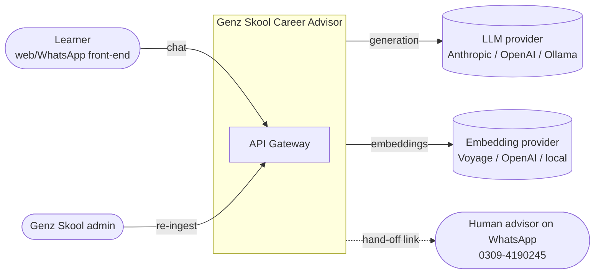
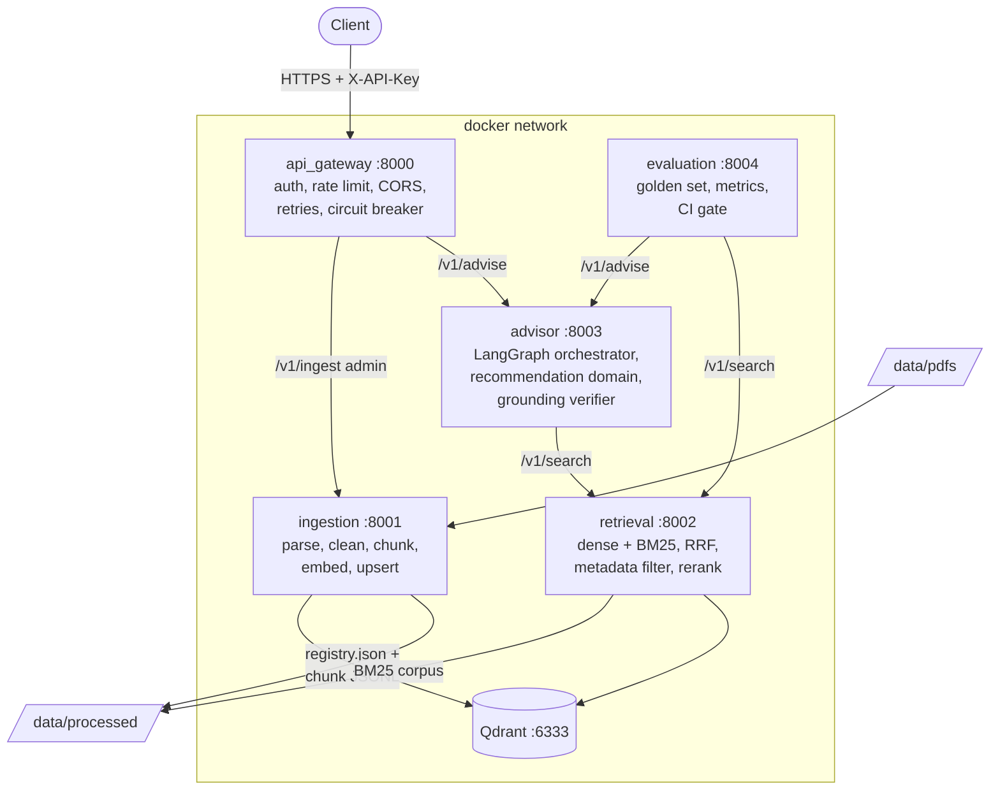
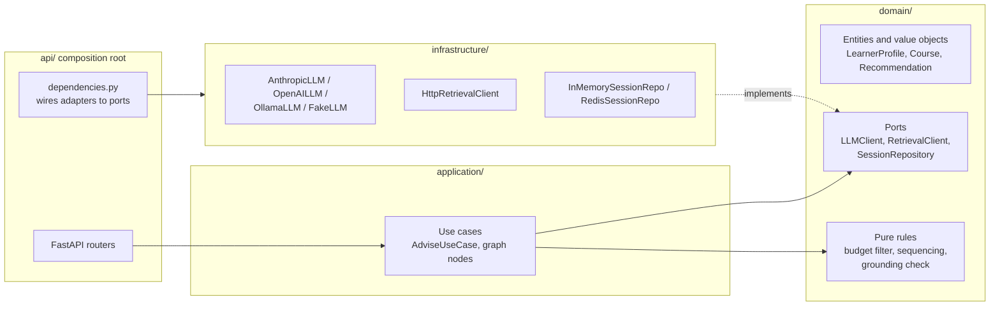
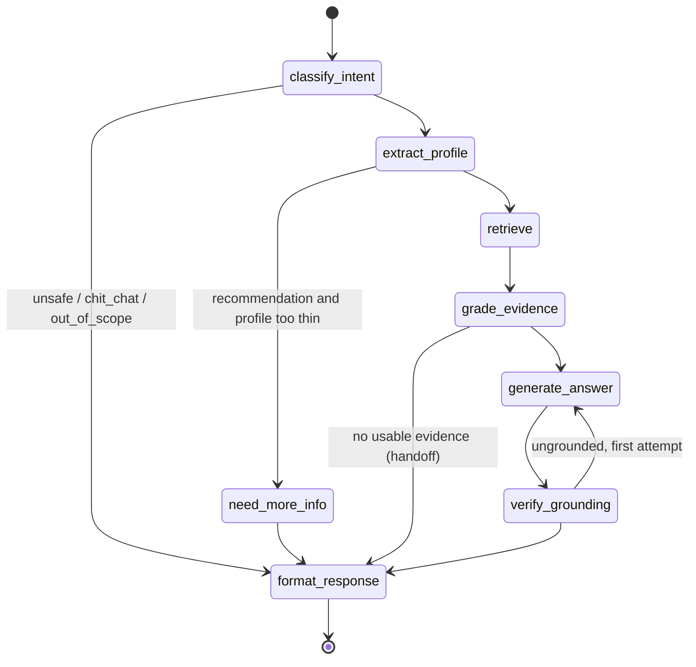

# Architecture: Genz Skool Career Advisor

A grounded RAG advisor that recommends Genz Skool courses from a learner's goals and
constraints, using **only** `data/pdfs/genzskool_knowledge_base.pdf` as the source of truth.

## 1. Forces that shape the design

| Force | Consequence |
|---|---|
| Corpus is tiny (5 pages, ~3-5k tokens, 8 courses, 6 mentors) | Retrieval quality is decided by **chunking and metadata**, not by the vector DB or embedding model. One chunk per semantic unit, rich metadata, filterable. |
| Business facts must be exact (fees, mentors, batches) | Eligibility, budget filtering and cost totals are **deterministic domain code**. The LLM only writes the explanation. A grounding verifier checks every number in the answer against the evidence. |
| Data is known to be stale and partly placeholder (PDF §9) | Every answer that touches fees/batches carries the WhatsApp confirmation line. No income, salary or outcome claims, ever. |
| Microservices + SOLID are required | Five small services, each hexagonal (ports and adapters) so they can collapse into a modular monolith later (ADR-0001). |
| Must run with no real keys | Every provider has a `fake` adapter. `LLM_PROVIDER=fake`, `EMBEDDING_PROVIDER=fake` is the default for tests, CI and first `docker compose up`. |

## 2. System context (C4 level 1)



## 3. Containers (C4 level 2)



| Service | Port | Owns | Talks to |
|---|---|---|---|
| `api_gateway` | 8000 | Public edge, auth, rate limits, envelope | advisor, ingestion |
| `ingestion` | 8001 | PDF to chunk to vector pipeline, index versions | Qdrant, embedding provider |
| `retrieval` | 8002 | Hybrid search, filtering, thresholds. **No generation.** | Qdrant, embedding provider |
| `advisor` | 8003 | Conversation, intent, profile, recommendation logic, answer, grounding | retrieval, LLM provider |
| `evaluation` | 8004 | Offline/online evaluation, regression gate | retrieval, advisor |

Services communicate **only** through HTTP/JSON contracts defined in `libs/common/contracts`.
No service imports another service's code.

## 4. Components inside a service (hexagonal)

Every service follows the same layout, using the advisor as the example:



Dependency rule: `api -> application -> domain <- infrastructure`. `domain/` imports nothing
third-party except `pydantic` and `typing`. This is enforced by `tests/architecture/test_layers.py`
(an AST import scan, so no extra dependency on import-linter).

## 5. Ingestion data flow

```mermaid
flowchart LR
    trig([startup / folder watcher /<br/>drift check / POST v1/ingest]) --> svc
    svc[IngestionService<br/>one at a time] --> load
    load[PdfPlumberLoader<br/>pdfplumber, fallback pypdf] -->|pages + tables| clean[StandardTextCleaner<br/>NFKC, strip footers]
    clean --> chunk[StructureAwareChunker<br/>course / mentor / policy /<br/>contact / overview]
    chunk --> hdr[Context header +<br/>metadata + content_hash]
    hdr --> embed[EmbeddingProvider<br/>batched, retry with backoff]
    embed --> upsert[VectorStore.upsert<br/>index_version N+1, verify count]
    upsert --> jsonl[/data/processed/doc.vN+1.chunks.jsonl/]
    jsonl --> swap[registry.json: activate N+1,<br/>then delete N]
```



- **Auto-ingest** (ADR-0011): on startup, then every `AUTO_INGEST_INTERVAL_S` the PDF folder is
  re-checked; new/changed PDFs are ingested, deleted ones pruned, and lost vectors re-created.
- **Idempotent**: the registry stores the file's `content_hash`; an unchanged file is a no-op
  (unless its vectors are missing, which triggers a self-healing re-ingest).
- **Blue/green**: new chunks are written under `index_version = N+1`; only after a full
  successful upsert does the registry flip the active version and delete version N. A partial
  failure leaves version N serving.
- **Chunk metadata**: `doc_id, source_file, page, section, doc_type, course_slug, category, level,
  fee_pkr, mentor, content_hash, ingested_at, index_version`.

## 6. One chat turn (sequence)

```mermaid
sequenceDiagram
    autonumber
    participant C as Client
    participant G as api_gateway
    participant A as advisor
    participant R as retrieval
    participant Q as Qdrant
    participant L as LLM

    C->>G: POST /api/chat {session_id, message} + X-API-Key
    G->>G: auth, rate limit, size limit, request-id
    G->>A: POST /v1/advise (timeout, retry, breaker)
    A->>A: classify_intent (rules first, LLM fallback)
    A->>A: extract_profile -> update session
    alt profile too thin for a recommendation
        A-->>G: <=2 clarifying questions
    else enough info
        A->>R: POST /v1/search {query, filters}
        R->>Q: dense search
        R->>R: BM25 + RRF + metadata filter + threshold
        R-->>A: chunks[] (possibly empty)
        A->>A: grade_evidence; domain rules pick eligible courses and total cost
        A->>L: generate_answer (evidence delimited as untrusted data)
        L-->>A: draft
        A->>A: verify_grounding (every number must appear in evidence)
        opt ungrounded claim
            A->>L: regenerate once, else safe fallback answer
        end
        A-->>G: answer + citations + WhatsApp reminder
    end
    G-->>C: envelope {data, request_id}
```

Graceful degradation: if retrieval is down or returns nothing, the advisor still answers with
the contact hand-off (WhatsApp 0309-4190245, info@genzskool.com, Mon-Sat 10am-8pm).

## 7. Advisor state machine



## 8. Cross-cutting concerns

| Concern | Where |
|---|---|
| Config | `config/*.yaml` (non-secret) + env via Pydantic `BaseSettings`, validated at startup (fail fast). |
| Secrets | `.env` only. `SecretStr` everywhere; a redaction filter scrubs keys, phones and emails from logs. |
| Logging | JSON lines with `request_id`, `service`, `path`, `latency_ms`. `X-Request-ID` is propagated across hops. |
| Errors | Typed hierarchy in `libs/common/errors`, one JSON error schema `{error: {code, message, request_id}}`, no stack traces to clients. |
| Health | `/healthz` (process alive), `/readyz` (dependencies reachable), `/metrics` (Prometheus). |
| Resilience | Timeouts on every call, retry with exponential backoff + jitter, circuit breaker in the gateway. |
| Prompts | Versioned files in `prompts/`, never inline strings in code. |

## 9. Decisions

See `docs/adr/`:

| ADR | Decision |
|---|---|
| 0001 | Microservices with hexagonal internals (collapsible to a modular monolith) |
| 0002 | Qdrant as vector store, with in-memory adapter for tests |
| 0003 | Hybrid retrieval: dense + BM25 fused with RRF |
| 0004 | Structure-aware chunking: one chunk per semantic unit |
| 0005 | Embedding provider separate from LLM provider; fake providers for offline mode |
| 0006 | Grounding verification of numeric claims, deterministic recommendation rules |
| 0007 | Session store behind a port; in-memory default |
| 0008 | Evaluation gate in CI with deterministic checks |
| 0009 | Supporting dependencies outside Section 4 (pydantic-settings, PyYAML, prometheus-client) |
| 0010 | Shared-library packaging and per-service `app` package layout |
| 0011 | Auto-ingest: startup run, PDF folder watcher, prune deleted, drift self-heal |
| 0012 | Embedding clients shared in `libs/common` so ingestion and retrieval cannot drift |
| 0013 | Advisor flow, LLM adapters (official Anthropic SDK), streaming only after verification |
